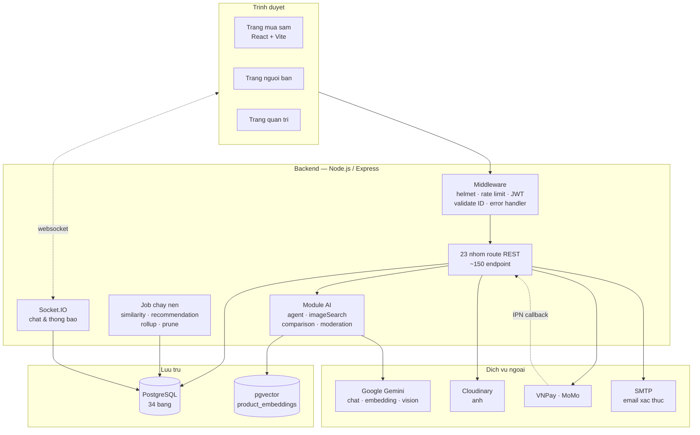
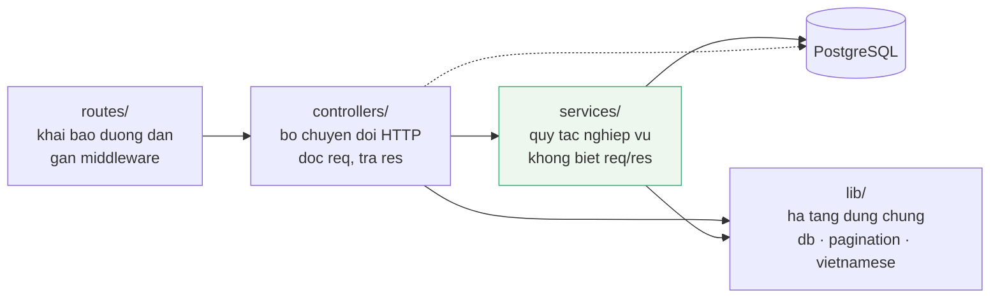
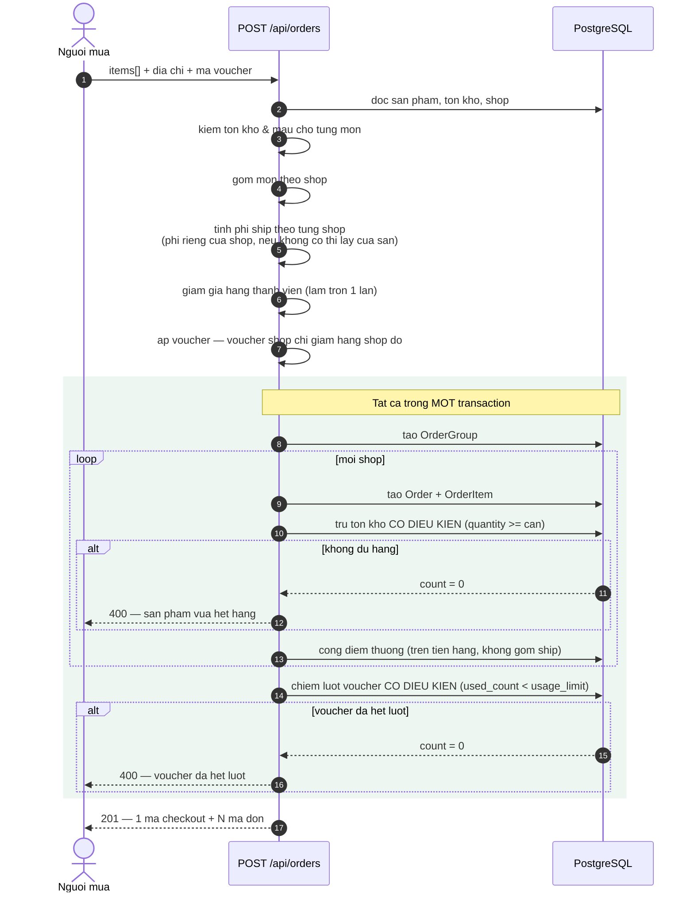
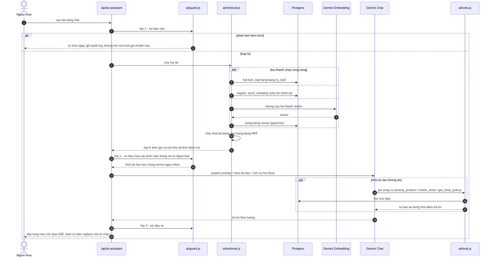
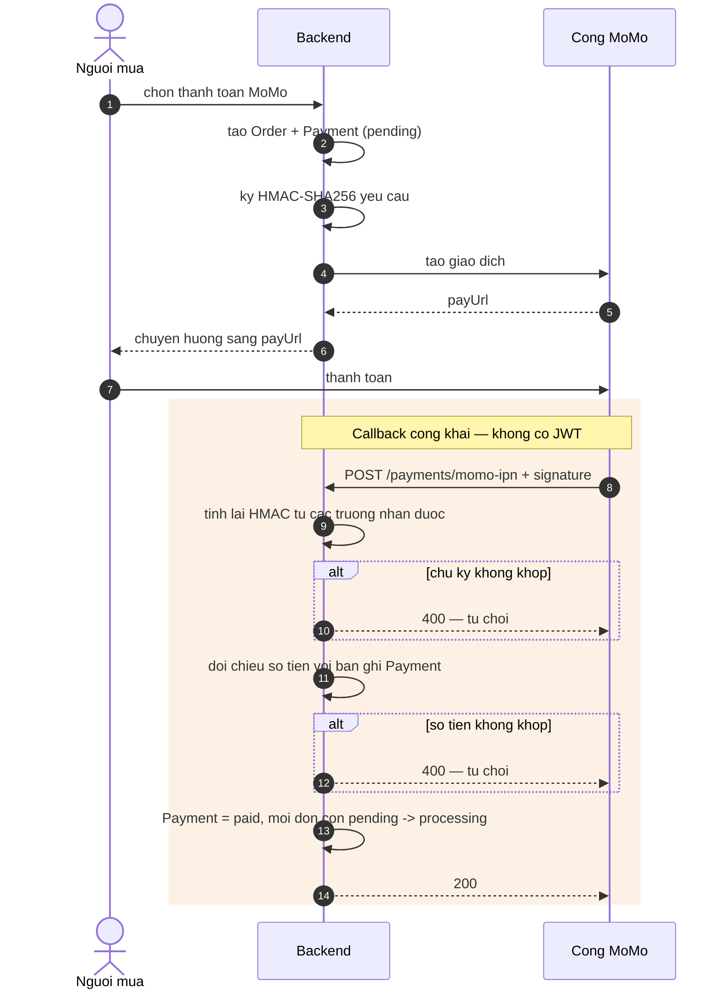
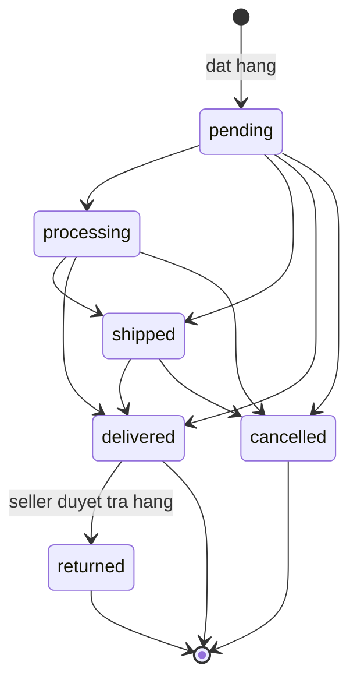
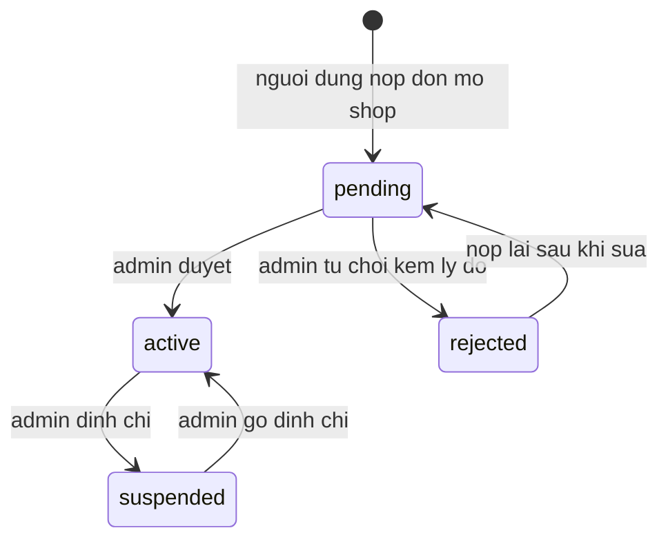
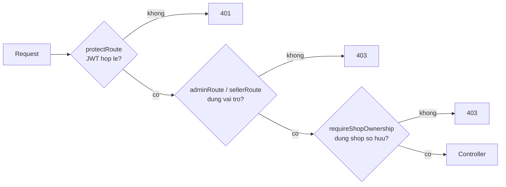

# Kien truc he thong va cac luong chinh

Tai lieu nay mo ta *hanh vi* cua he thong. So do cau truc du lieu nam o
[`erd.md`](./erd.md) va duoc sinh tu dong tu schema.

Moi so do duoi day viet bang Mermaid nen hien thi truc tiep tren GitHub va
trong VS Code (extension Markdown Preview Mermaid Support).

---

## 1. Kien truc tong the



**Diem dang chu y**: callback IPN tu cong thanh toan di *nguoc* vao backend
qua duong cong khai, khong co JWT — nen chu ky HMAC la lop xac thuc duy nhat
o day (xem muc 4).

---


### Phan tang trong backend



Quy tac mot chieu: **route → controller → service → du lieu**. Khong bao gio
nguoc lai, va **khong bao gio controller import controller**.

Truoc dot don kien truc, quy tac nay bi pha o 8 cho: `writeAuditLog` nam trong
`audit.controller.js` va duoc 5 controller khac import nguoc ra, con quy tac
tich diem va hang thanh vien thi nam trong `loyalty.controller.js` va bi
`order.controller.js`, `return.controller.js`, `customer.controller.js` keo ra
dung. Hau qua khong chi la kho doc: mot job chay nen hay mot bai test muon cong
diem cho don hang deu phai import ca mot module HTTP, keo theo ca tang khong
lien quan gi den viec no can lam.

| Tang | Duoc phep biet | Khong duoc biet |
|---|---|---|
| `routes/` | controller, middleware | nghiep vu, DB |
| `controllers/` | service, lib, prisma | controller khac |
| `services/` | lib, prisma, service khac | req, res, ma trang thai HTTP |
| `lib/` | khong gi trong hai tang tren | controller, service |

`services/pricing.service.js` la vi du ro nhat cho cot cuoi: khi voucher khong
hop le, no tra ve `{ ok: false, code: "COUPON_EXPIRED" }` chu khong tra
`res.status(400)`. Tang HTTP la noi duy nhat biet ma trang thai la gi. Nho vay
toan bo quy tac tinh tien kiem thu duoc bang ham thuan, khong can dung mot
request nao — xem `tests/15-pricing.test.mjs`.

---

## 2. Luong then chot: tach don khi thanh toan

Day la bai toan kho nhat cua mo hinh da gian hang. Mot lan bam mua tao ra
**mot `OrderGroup`** va **N `Order`** — moi shop mot don voi trang thai rieng —
nhung tong tien cac don con phai khop *tuyet doi* voi so tien thanh toan.



### Hai bat bien phai giu

**Tien phai khop.** Khuyen mai duoc chia theo ti le gia tri cua tung shop;
**don cuoi cung hap thu phan sai so lam tron** de tong cac don con luon bang
dung tong thanh toan. Ngoai ra moi khoan giam gia deu duoc lam tron *mot lan
tai diem tinh* — neu lam tron luc luu ma tinh tong tu gia tri chua lam tron
thi bang chi tiet se lech 1 xu so voi tong.

**Khong ban vuot kho.** Ca tru ton kho lan chiem luot voucher deu dung *cap
nhat co dieu kien* thay vi doc-roi-ghi. PostgreSQL danh gia lai menh de `WHERE`
sau khi giao dich truoc commit, nen nguoi den sau nhan `count = 0` va giao dich
cua ho bi huy — thay vi ca hai cung di lot.

---

## 3. Luong AI: tro ly ao (truy hoi lai + goi cong cu + phong thu tiem lenh)



### Vi sao hop nhat bang RRF chu khong cong diem

Ba nhanh tra ve ba thang do khac nhau: `ts_rank` la so thuc khong chan tren,
`word_similarity` nam trong khoang 0-1, con vector tra ve *khoang cach* (cang
nho cang tot). Cong thang ba so nay lai la so sanh khap khieng. Reciprocal Rank
Fusion chi dung **thu hang**:

```
score(d) = tong cua  weight_i / (k + rank_i(d)),   k = 60
```

Nho vay khong can chuan hoa thang do, va tai lieu duoc nhieu nhanh cung tim
thay se tu dong len tren. Nhanh trigram mang trong so 0.5 vi no la luoi an toan
cho loi go phim, nhieu hon hai nhanh kia.

Phan cong vai tro giua hai tang:

| Tang | Nhiem vu | Khong lam gi |
|---|---|---|
| Truy hoi lai | TIM ung vien phu hop voi cau hoi | Khong phai nguon so lieu |
| Cong cu / khoi du lieu | Cung cap SO LIEU tai thoi diem tra loi | Khong quyet dinh san pham nao lien quan |

Day la diem mau chot voi du lieu thuong mai dien tu: gia va ton kho doi lien
tuc, trong khi vector nhung chi duoc sinh lai theo chu ky. Neu de mo hinh doc
gia tu noi dung da nhung thi cau tra loi la anh chup cua qua khu.

### Ba lop phong thu tiem lenh

San da gian hang co mot be mat tan cong ma cua hang mot chu khong co: **mo ta
san pham do nguoi ban tu nhap duoc nap thang vao ngu canh cua phien chat cua
nguoi mua khac**. Vi vay phong thu khong the chi loc dau vao.

| Lop | Cho | Chan gi |
|---|---|---|
| 1. Dau vao | truoc khi goi model | ep vai, doi voucher, moi lo system prompt, payload qua dai |
| 2. Ngu canh | khi dung khoi du lieu | cau lenh giau trong mo ta nguoi ban; boc trong nonce de khong the dong khoi som |
| 3. Dau ra | truoc khi tra ve | tu hua gia rieng, tu cap ma giam gia khong co trong DB, lo nonce |

Lop 1 dang gia nhat ve mat chi phi: chan tai cho, khong ton luot goi model nao.
Moi lan chan deu ghi `AI_GUARD_BLOCK` vao nhat ky thao tac, vua de quan tri vien
xem duoc, vua la nguon so lieu cho chi tieu ti le chan tan cong.

Danh doi cua streaming: lop 3 chi chay duoc khi da co tron cau tra loi, luc do
nguoi dung da doc duoc vai dong. Vi vay endpoint SSE phat them su kien
`replace` de client thay toan bo noi dung; ban ghi luu vao co so du lieu luon la
ban da qua kiem tra.

---


## 4. Luong thanh toan MoMo va xac thuc callback



Buoc tinh lai chu ky la **bat buoc**: neu bo qua, bat ky ai doan duoc
`requestId` cung co the gui callback gia de danh dau don da thanh toan ma
khong tra dong nao. Suite `09-payment-security` khoa lai dung truong hop nay.

---

## 5. May trang thai don hang



Ba trang thai cuoi la `delivered`, `cancelled`, `returned`. Rieng `returned`
**khong** dat duoc bang cach doi trang thai truc tiep — chi luong duyet yeu cau
tra hang moi dua don sang do, dong thoi hoan kho va thu hoi diem thuong.

Nguoi mua chi tu huy duoc khi don con o `pending` hoac `processing`.

> Bang chuyen trang thai nay dat tai `constants/status.js` va la nguon su that
> duy nhat. Truoc day seed tung sinh trang thai `confirmed` khong co trong bang,
> khien nhung don do ket vinh vien — khong chuyen tiep duoc ma cung khong huy
> duoc. Suite `11-business-rules` kiem tra khong con trang thai la nao.

---

## 6. Vong doi gian hang



Khi shop roi khoi `active`, toan bo san pham cua shop bien mat khoi trang chu,
tim kiem, goi y AI va khong the them vao gio. Rang buoc nay ap o **tang truy
van du lieu** (`buyerVisibilityWhere` trong `lib/productQuery.js`) chu khong va
o tung man hinh — nen khong co duong nao lot.

---

## 7. Phan quyen ba lop



Lop thu ba la lop quan trong nhat va cung de quen nhat: no ngan seller A doc
don hang hay sua san pham cua seller B. Chi kiem tra vai tro thoi thi *chua du*,
vi ca hai deu co vai tro `seller`.
