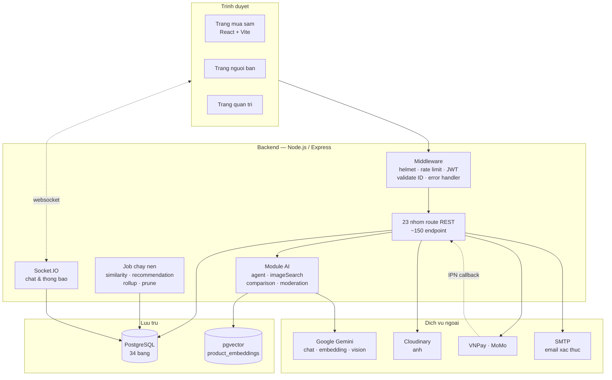
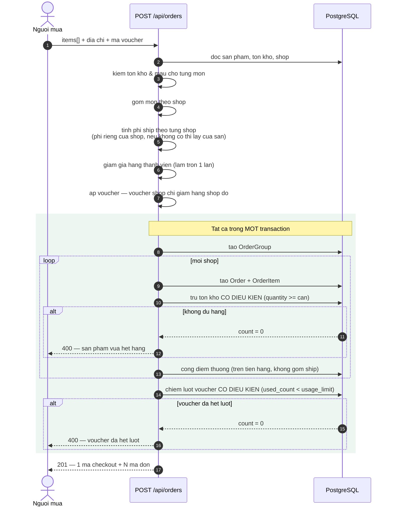
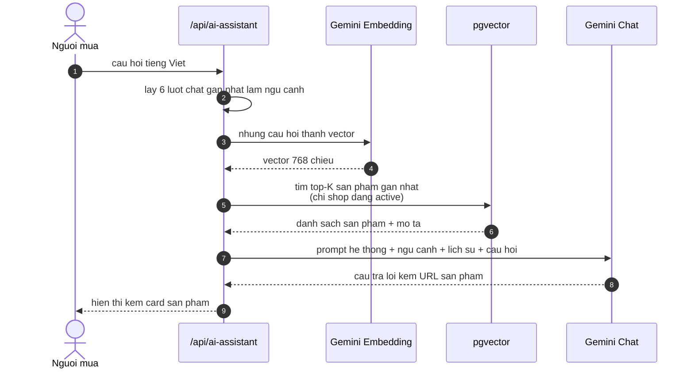
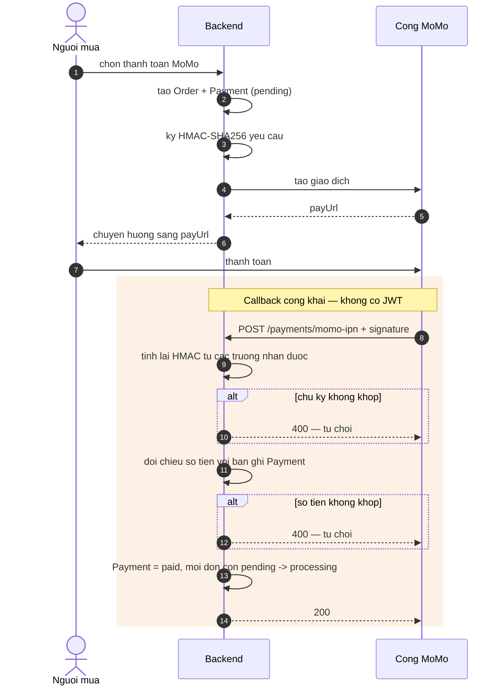
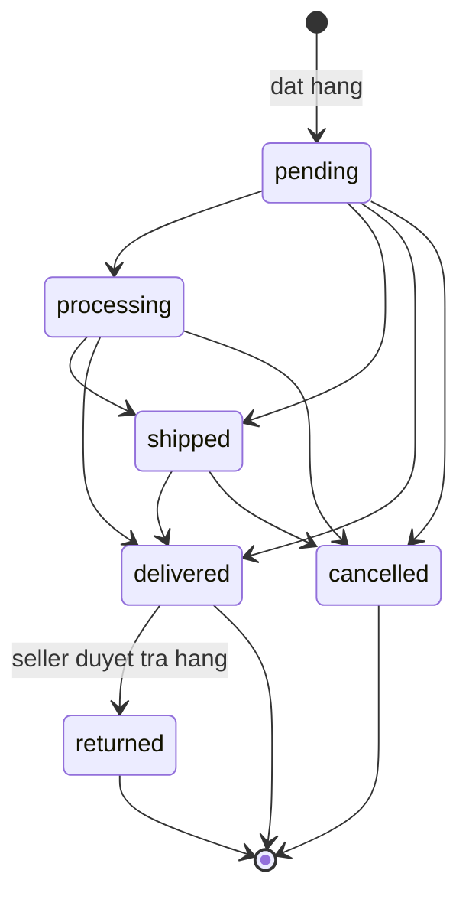
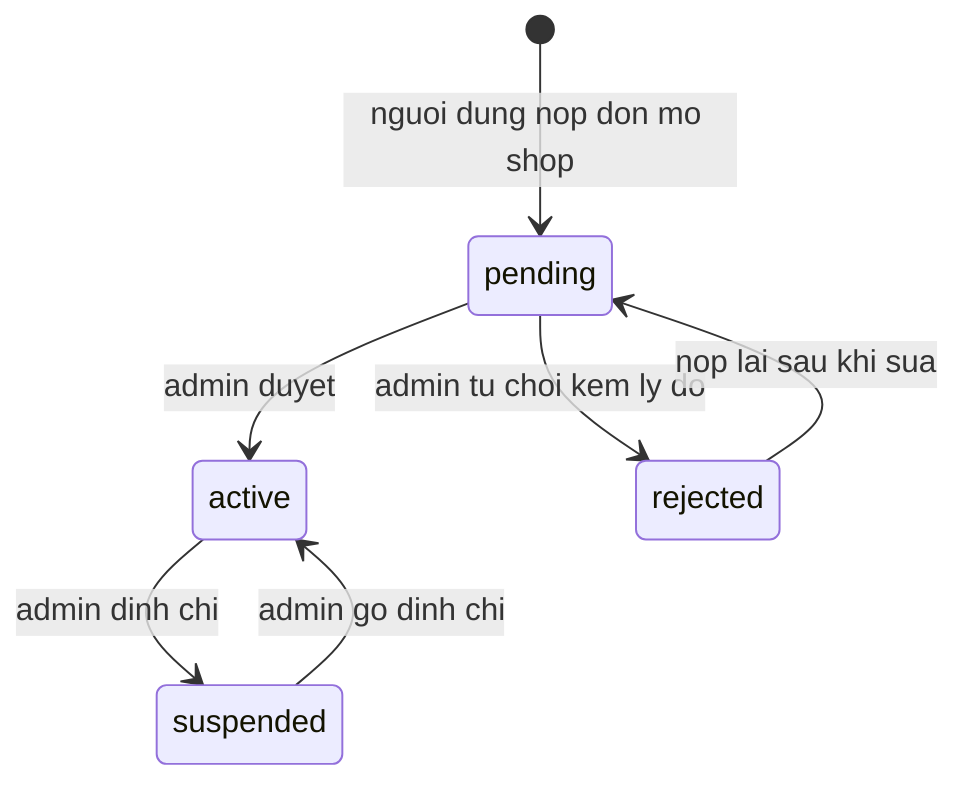
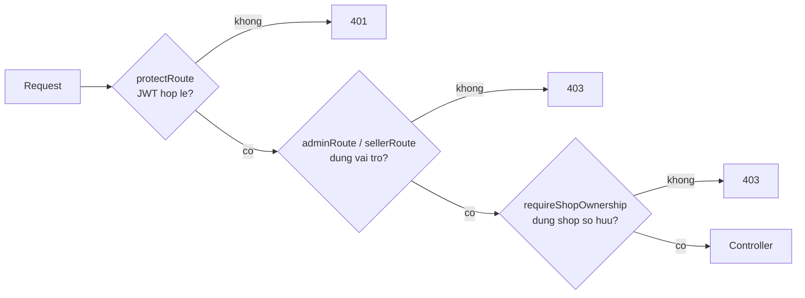

# Kien truc he thong va cac luong chinh

Tai lieu nay mo ta *hanh vi* cua he thong. So do cau truc du lieu nam o
[`erd.md`](./erd.md) va duoc sinh tu dong tu schema.

Moi so do duoi day viet bang Mermaid nen hien thi truc tiep tren GitHub va
trong VS Code (extension Markdown Preview Mermaid Support).

---

## 1. Kien truc tong the

**Diem dang chu y**: callback IPN tu cong thanh toan di *nguoc* vao backend
qua duong cong khai, khong co JWT — nen chu ky HMAC la lop xac thuc duy nhat
o day (xem muc 4).

---

## 2. Luong then chot: tach don khi thanh toan

Day la bai toan kho nhat cua mo hinh da gian hang. Mot lan bam mua tao ra
**mot `OrderGroup`** va **N `Order`** — moi shop mot don voi trang thai rieng —
nhung tong tien cac don con phai khop *tuyet doi* voi so tien thanh toan.

### Hai bat bien phai giu

**Tien phai khop.** Khuyen mai duoc chia theo ti le gia tri cua tung shop;
**don cuoi cung hap thu phan sai so lam tron** de tong cac don con luon bang
dung tong thanh toan. Ngoai ra moi khoan giam gia deu duoc lam tron *mot lan
tai diem tinh* — neu lam tron luc luu ma tinh tong tu gia tri chua lam tron
thi bang chi tiet se lech 1 xu so voi tong.

**Khong ban vuot kho.** Ca tru ton kho lan chiem luot voucher deu dung *cap
nhat co dieu kien* thay vi doc-roi-ghi. PostgreSQL danh gia lai menh de `WHERE`
sau khi giao dich truoc commit, nen nguoi den sau nhan `count = 0` va giao dich
cua ho bi huy — thay vi ca hai cung di lot.

---

## 3. Luong AI: chatbot tu van (RAG)

Truy hoi chay song song hai duong: **tu khoa** (LIKE, tham so hoa) va **vector**
(pgvector), roi hop nhat va xep hang. Neu chua co embedding thi he thong tu dong
lui ve tim theo tu khoa — chay duoc nhung chat luong giam ro, va **khong bao loi**,
nen `npm run test:demo` co han mot phep kiem tra bang `product_embeddings`.

---

## 4. Luong thanh toan MoMo va xac thuc callback

Buoc tinh lai chu ky la **bat buoc**: neu bo qua, bat ky ai doan duoc
`requestId` cung co the gui callback gia de danh dau don da thanh toan ma
khong tra dong nao. Suite `09-payment-security` khoa lai dung truong hop nay.

---

## 5. May trang thai don hang

Ba trang thai cuoi la `delivered`, `cancelled`, `returned`. Rieng `returned`
**khong** dat duoc bang cach doi trang thai truc tiep — chi luong duyet yeu cau
tra hang moi dua don sang do, dong thoi hoan kho va thu hoi diem thuong.

Nguoi mua chi tu huy duoc khi don con o `pending` hoac `processing`.

> Bang chuyen trang thai nay dat tai `constants/status.js` va la nguon su that
> duy nhat. Truoc day seed tung sinh trang thai `confirmed` khong co trong bang,
> khien nhung don do ket vinh vien — khong chuyen tiep duoc ma cung khong huy
> duoc. Suite `11-business-rules` kiem tra khong con trang thai la nao.

---

## 6. Vong doi gian hang

Khi shop roi khoi `active`, toan bo san pham cua shop bien mat khoi trang chu,
tim kiem, goi y AI va khong the them vao gio. Rang buoc nay ap o **tang truy
van du lieu** (`buyerVisibilityWhere` trong `lib/productQuery.js`) chu khong va
o tung man hinh — nen khong co duong nao lot.

---

## 7. Phan quyen ba lop

Lop thu ba la lop quan trong nhat va cung de quen nhat: no ngan seller A doc
don hang hay sua san pham cua seller B. Chi kiem tra vai tro thoi thi *chua du*,
vi ca hai deu co vai tro `seller`.
