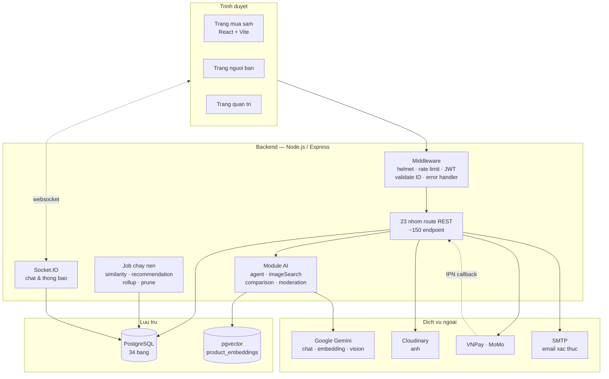
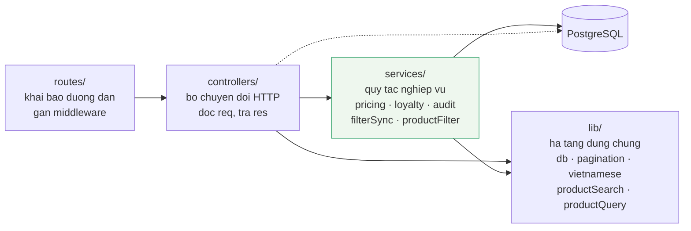
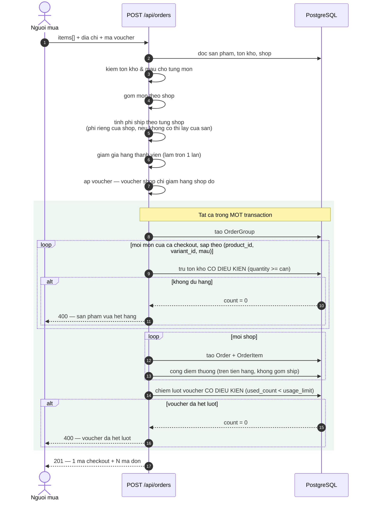
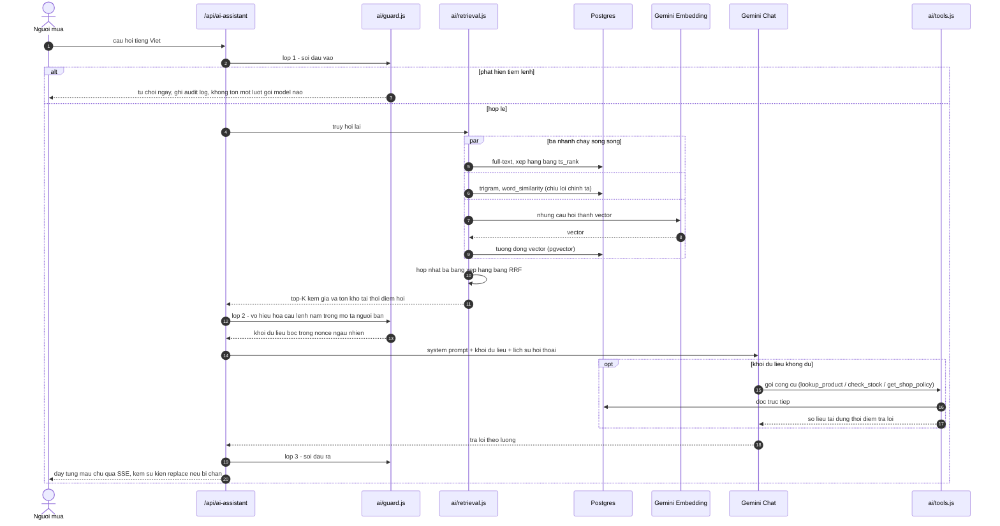
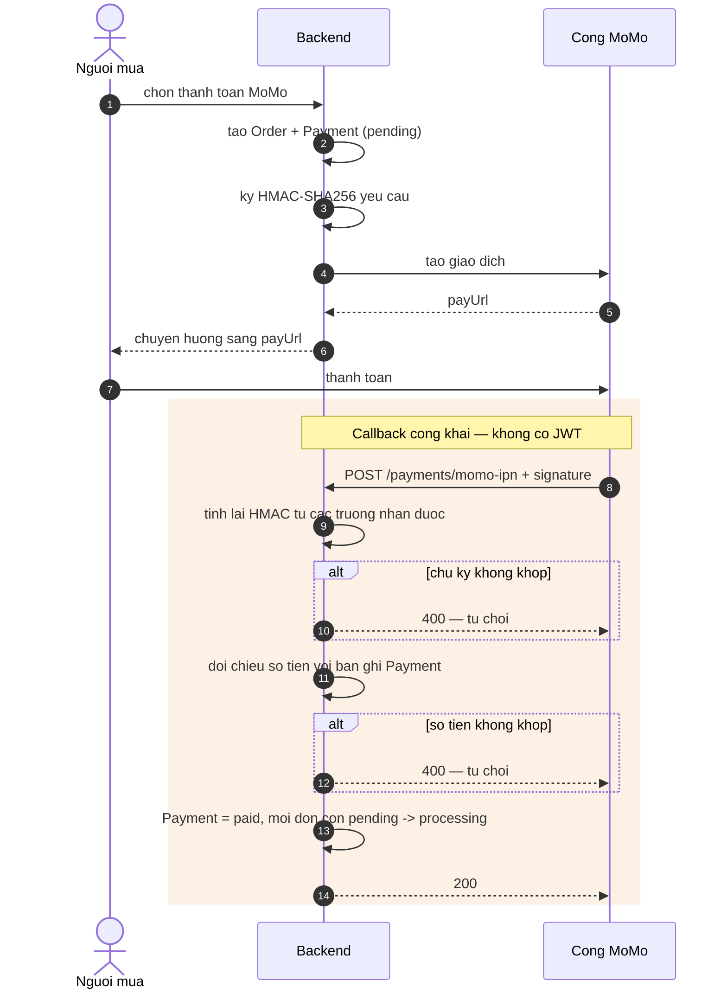
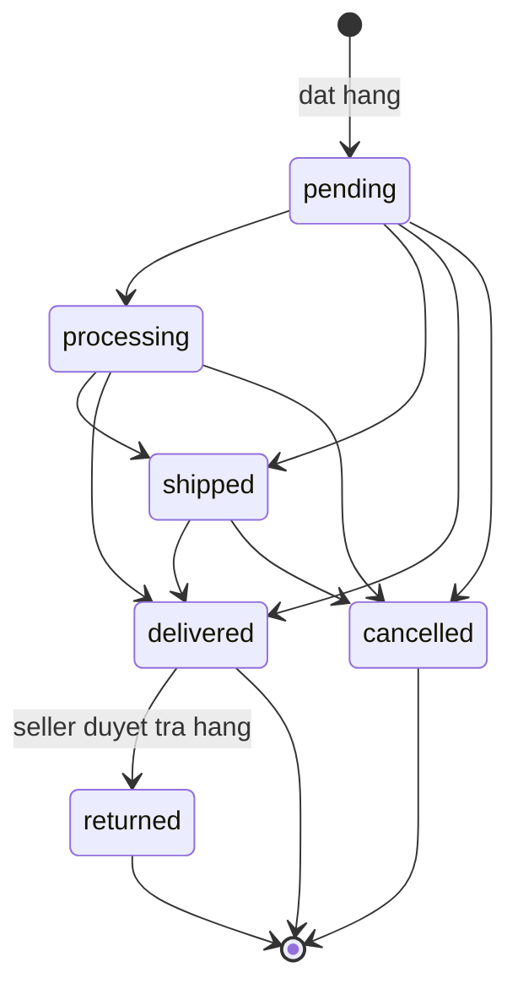
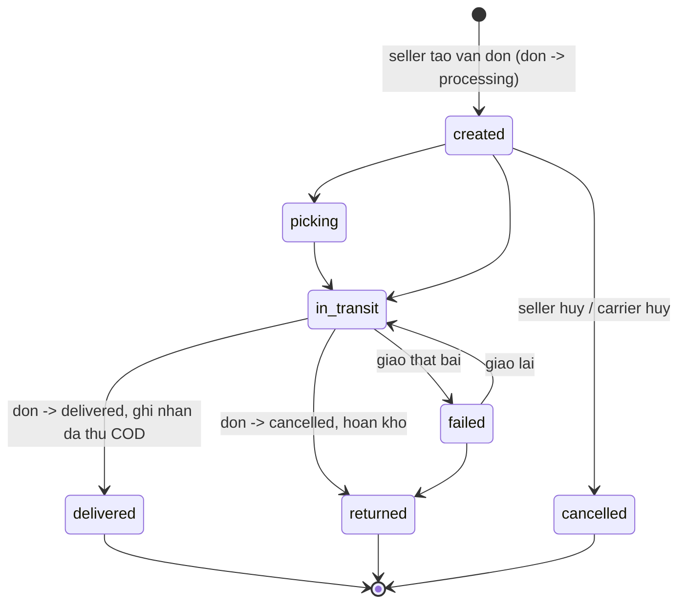
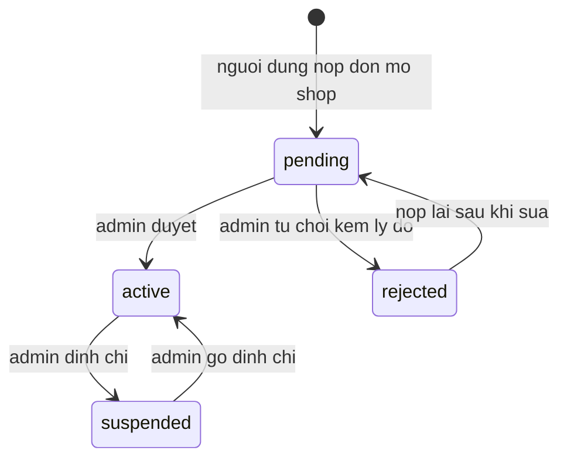
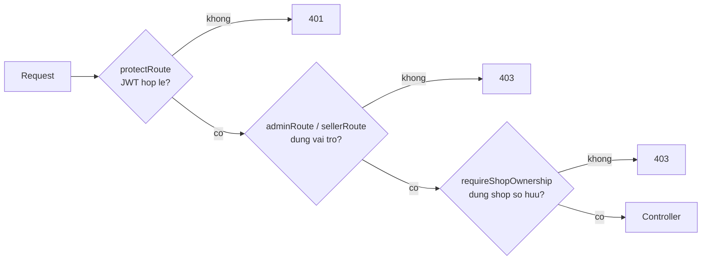

# Kien truc he thong va cac luong chinh

Tai lieu nay mo ta *hanh vi* cua he thong. So do cau truc du lieu nam o
[`erd.md`](./erd.md) va duoc sinh tu dong tu schema.

Moi so do duoi day viet bang Mermaid nen hien thi truc tiep tren GitHub va
trong VS Code (extension Markdown Preview Mermaid Support).

---

## 1. Kien truc tong the



**Diem dang chu y**: callback IPN tu cong thanh toan di *nguoc* vao backend
qua duong cong khai, khong co JWT — nen chu ky HMAC la lop xac thuc duy nhat
o day (xem muc 4).

---


### Phan tang trong backend



Quy tac mot chieu: **route → controller → service → du lieu**. Khong bao gio
nguoc lai, va **khong bao gio controller import controller**.

Truoc dot don kien truc, quy tac nay bi pha o 8 cho: `writeAuditLog` nam trong
`audit.controller.js` va duoc 5 controller khac import nguoc ra, con quy tac
tich diem va hang thanh vien thi nam trong `loyalty.controller.js` va bi
`order.controller.js`, `return.controller.js`, `customer.controller.js` keo ra
dung. Hau qua khong chi la kho doc: mot job chay nen hay mot bai test muon cong
diem cho don hang deu phai import ca mot module HTTP, keo theo ca tang khong
lien quan gi den viec no can lam.

| Tang | Duoc phep biet | Khong duoc biet |
|---|---|---|
| `routes/` | controller, middleware | nghiep vu, DB |
| `controllers/` | service, lib, prisma | controller khac |
| `services/` | lib, prisma, service khac | req, res, ma trang thai HTTP |
| `lib/` | khong gi trong hai tang tren | controller, service |

### Hai thu bi dat nham tang

Ngoai huong phu thuoc, con hai cho bi dat sai cho ma chi lo ra khi doc lai ca cay thu muc:

- **Kha nang tim kiem nam trong `ai/`.** Full-text, trigram va phep hop nhat RRF
  duoc viet trong `ai/retrieval.js` vi chatbot can chung truoc. Nhung chung khong
  co gi rieng cua AI ca - do la kha nang tim kiem cua chinh catalog. Hau qua rat cu
  the: o tim kiem cua nguoi dung, thu can chiu loi go phim nhat, van ket o `contains`
  va tra ve rong khi go "iphon", trong khi chatbot ngay ben canh da co day du cong cu.
  Chuyen sang `lib/productSearch.js` thi ca hai cung dung mot duong.
- **Goi y o tim kiem.** `GET /products/suggest?q=` (`services/searchSuggest.service.js`)
  tra san pham (tai dung `findSearchCandidateIds` + `buyerVisibilityWhere`), danh muc,
  gian hang dang hoat dong. `q` rong tra `trending` (2 tu dau ten san pham ban chay +
  danh muc, cache trong bo nho 60s); `q` > 100 ky tu tra 400.
- **Xu ly loi lap 147 lan.** `asyncHandler` va `AppError` da duoc viet san trong
  `middleware/error.middleware.js` nhung khong noi nao dung, con moi handler thi tu
  viet mot khoi `try/catch` chi de log roi tra 500. Ha tang co san ma khong ai dung
  la ha tang chet. Da boc 129 handler bang `asyncHandler`; loi bay gio di ve mot cho,
  va ma loi cua Prisma duoc anh xa sang status co nghia thay vi 500 cho tat ca.

`services/pricing.service.js` la vi du ro nhat cho cot cuoi: khi voucher khong
hop le, no tra ve `{ ok: false, code: "COUPON_EXPIRED" }` chu khong tra
`res.status(400)`. Tang HTTP la noi duy nhat biet ma trang thai la gi. Nho vay
toan bo quy tac tinh tien kiem thu duoc bang ham thuan, khong can dung mot
request nao — xem `tests/15-pricing.test.mjs`.

### Quy tac voucher (mot cho duy nhat)

`resolveCouponDiscount` trong `services/pricing.service.js` la noi DUY NHAT
quyet dinh voucher co dung duoc khong. `createOrder`, `POST /coupons/validate`,
`POST /coupons/validate-my` va `POST /coupons/quote` deu goi vao no (ba endpoint
xem truoc di qua `previewCouponDiscount`, nhan `amount` + `shop_amounts`).
Thu tu kiem tra:

1. `couponStatus`: `is_active=false` → `COUPON_PAUSED`; `starts_at` o tuong lai →
   `COUPON_NOT_STARTED`; qua `expires_at` → `COUPON_EXPIRED`; het `usage_limit` →
   `COUPON_LIMIT_REACHED`; nguoi mua da dung du `per_user_limit` (null = khong
   gioi han) → `used_by_you` / `COUPON_ALREADY_USED` ("You have already used this
   voucher"). So lan dung (`userUses`) do `countUserCouponUses` trong
   `coupon.service.js` dem: dem `order_groups` cua nguoi mua co it nhat mot don chua
   huy, nen checkout nhieu shop chi tinh mot lan va huy don tra luot. Kho voucher
   hien `used_by_you` o tab Expired / Used.
2. Voucher ca nhan (`Coupon.users` khac rong) chi dung cho dung nguoi →
   `COUPON_NOT_OWNED` (403).
3. Pham vi: voucher shop chi tinh tren phan hang cua shop do (`COUPON_SHOP_MISSING`),
   `min_order` so voi phan hang shop; voucher san so voi ca gio.
4. Voucher phan tram bi chan boi `max_discount`, va khong bao gio vuot tien hang.

Tai `createOrder`, sau khi `updateMany` chiem `used_count` (giu khoa dong voucher)
trong cung transaction, dem lai luot dung cua nguoi mua; vuot `per_user_limit` thi
rollback → 400, nen hai checkout song song cua cung nguoi khong lot qua gioi han.

`couponStatus` cung la nguon cho chip trang thai o kho voucher, trang seller va admin.

**Luu voucher.** `services/coupon.service.js`: `POST /coupons/:id/claim` ghi
`coupon_claims` (unique user+coupon, goi lai van mot ban ghi). Chi voucher cong
khai (`users` rong), dang bat, chua het han/het luot. Kho voucher (`GET /coupons/my`)
= voucher ca nhan + voucher da luu, kem `status` va `source`. `GET /coupons/claimable`
va `GET /coupons/shop/:slug` tra them co `claimed` cho nguoi dang xem. Nhap tay ma
cong khai o checkout van dung duoc ma khong can luu; luu chi de hien trong kho va
de checkout tu chon voucher giam nhieu nhat trong kho.

---

## 2. Luong then chot: tach don khi thanh toan

Day la bai toan kho nhat cua mo hinh da gian hang. Mot lan bam mua tao ra
**mot `OrderGroup`** va **N `Order`** — moi shop mot don voi trang thai rieng —
nhung tong tien cac don con phai khop *tuyet doi* voi so tien thanh toan.



### Hai bat bien phai giu

**Tien phai khop.** Khuyen mai duoc chia theo ti le gia tri cua tung shop;
**don cuoi cung hap thu phan sai so lam tron** de tong cac don con luon bang
dung tong thanh toan. Ngoai ra moi khoan giam gia deu duoc lam tron *mot lan
tai diem tinh* — neu lam tron luc luu ma tinh tong tu gia tri chua lam tron
thi bang chi tiet se lech 1 xu so voi tong.

**Khong ban vuot kho.** Ca tru ton kho lan chiem luot voucher deu dung *cap
nhat co dieu kien* thay vi doc-roi-ghi. PostgreSQL danh gia lai menh de `WHERE`
sau khi giao dich truoc commit, nen nguoi den sau nhan `count = 0` va giao dich
cua ho bi huy — thay vi ca hai cung di lot.

**Khoa theo mot thu tu co dinh.** Moi UPDATE khoa dong toi cuoi giao dich. Neu
tru kho theo thu tu trong gio, hai gio {X, Y} va {Y, X} dat cung luc se moi ben
giu mot dong va cho dong kia — Postgres bao deadlock (40P01) va huy mot ben, nguoi
mua nhan loi du hang con du. Vi vay buoc tru kho chay mot lan cho ca checkout,
sap theo `(product_id, variant_id, mau)`. Lop phong ho: `lib/transaction.js`
(`withTxConflictRetry`) chay lai giao dich bi huy vi deadlock/xung dot toi da 3
lan; van khong duoc thi tra 409 `CHECKOUT_BUSY`. Loi 500 khong tra
`error.message` ra ngoai. Xem `tests/51-order-concurrency`.

**Hoan kho khoa cung thu tu.** Huy don, duyet tra hang va xoa don deu cong kho
qua `lib/restock.js`, cung khoa cac dong ay. Thu tu khoa nam o MOT cho,
`lib/stockLock.js`: sap mon theo `(product_id, variant_id, mau)`, trong moi mon
bien the -> mau -> san pham. Ca checkout lan hoan kho dung no; them noi nao cham
vao kho thi cung phai dung. Ba giao dich hoan kho (`transitionOrderStatus`,
duyet tra hang, `deleteOrder`) cung boc `withTxConflictRetry`, het luot thi tra
409. Xem `tests/53-restock-concurrency`.

---

## 3. Luong AI: tro ly ao (truy hoi lai + goi cong cu + phong thu tiem lenh)



### Vi sao hop nhat bang RRF chu khong cong diem

Ba nhanh tra ve ba thang do khac nhau: `ts_rank` la so thuc khong chan tren,
`word_similarity` nam trong khoang 0-1, con vector tra ve *khoang cach* (cang
nho cang tot). Cong thang ba so nay lai la so sanh khap khieng. Reciprocal Rank
Fusion chi dung **thu hang**:

```
score(d) = tong cua  weight_i / (k + rank_i(d)),   k = 60
```

Nho vay khong can chuan hoa thang do, va tai lieu duoc nhieu nhanh cung tim
thay se tu dong len tren. Nhanh trigram mang trong so 0.5 vi no la luoi an toan
cho loi go phim, nhieu hon hai nhanh kia.

Rieng o tim kiem cua nguoi dung (`findSearchCandidateIds`) con mot nhanh phu
`searchSubstring`, trong so 0.5: khop chuoi con khong dau tren ten san pham + ten
danh muc, moi token deu phai xuat hien. Nho no ma go do "lap" ra laptop, "xiao"
ra Xiaomi - full-text chi khop tron tu, trigram can token >= 4 ky tu. Chatbot
khong dung nhanh nay.

Phan cong vai tro giua hai tang:

| Tang | Nhiem vu | Khong lam gi |
|---|---|---|
| Truy hoi lai | TIM ung vien phu hop voi cau hoi | Khong phai nguon so lieu |
| Cong cu / khoi du lieu | Cung cap SO LIEU tai thoi diem tra loi | Khong quyet dinh san pham nao lien quan |

Day la diem mau chot voi du lieu thuong mai dien tu: gia va ton kho doi lien
tuc, trong khi vector nhung chi duoc sinh lai theo chu ky. Neu de mo hinh doc
gia tu noi dung da nhung thi cau tra loi la anh chup cua qua khu.

### Ba lop phong thu tiem lenh

San da gian hang co mot be mat tan cong ma cua hang mot chu khong co: **mo ta
san pham do nguoi ban tu nhap duoc nap thang vao ngu canh cua phien chat cua
nguoi mua khac**. Vi vay phong thu khong the chi loc dau vao.

| Lop | Cho | Chan gi |
|---|---|---|
| 1. Dau vao | truoc khi goi model | ep vai, doi voucher, moi lo system prompt, payload qua dai |
| 2. Ngu canh | khi dung khoi du lieu | cau lenh giau trong mo ta nguoi ban; boc trong nonce de khong the dong khoi som |
| 3. Dau ra | truoc khi tra ve | tu hua gia rieng, tu cap ma giam gia khong co trong DB, lo nonce |

Lop 1 dang gia nhat ve mat chi phi: chan tai cho, khong ton luot goi model nao.
Moi lan chan deu ghi `AI_GUARD_BLOCK` vao nhat ky thao tac, vua de quan tri vien
xem duoc, vua la nguon so lieu cho chi tieu ti le chan tan cong.

Danh doi cua streaming: lop 3 chi chay duoc khi da co tron cau tra loi, luc do
nguoi dung da doc duoc vai dong. Vi vay endpoint SSE phat them su kien
`replace` de client thay toan bo noi dung; ban ghi luu vao co so du lieu luon la
ban da qua kiem tra.

---


## 4. Luong thanh toan MoMo va xac thuc callback



Buoc tinh lai chu ky la **bat buoc**: neu bo qua, bat ky ai doan duoc
`requestId` cung co the gui callback gia de danh dau don da thanh toan ma
khong tra dong nao. Suite `09-payment-security` khoa lai dung truong hop nay.

Thanh toan lai ("Pay now" o trang don hang): `POST /payments/momo/retry
{order_group_id}` chi chay khi checkout thuoc nguoi goi, moi don con song deu
`pending` va khong phai COD, chua co Payment `paid`, va chua qua
`order_payment_timeout_minutes` (cung moc voi job `expire-unpaid-orders`).
Payment `pending` cu bi chuyen `canceled` roi tao giao dich moi qua dung code
`createMomoPayment`. Suite `36-momo-retry` kiem cac nhanh tu choi.

---

## 5. May trang thai don hang



Ba trang thai cuoi la `delivered`, `cancelled`, `returned`. Rieng `returned`
**khong** dat duoc bang cach doi trang thai truc tiep — chi luong duyet yeu cau
tra hang moi dua don sang do, dong thoi hoan kho va thu hoi diem thuong.

Nguoi mua chi tu huy duoc khi don con o `pending` hoac `processing`.
`PATCH /orders/:id/cancel` nhan `reason` tuy chon (chuoi, cat 200 ky tu): luu vao
`metadata.reason` cua audit log `ORDER_CANCEL` va gui kem thong bao cho seller,
khong co cot rieng trong schema.

> Bang chuyen trang thai nay dat tai `constants/status.js` va la nguon su that
> duy nhat. Truoc day seed tung sinh trang thai `confirmed` khong co trong bang,
> khien nhung don do ket vinh vien — khong chuyen tiep duoc ma cung khong huy
> duoc. Suite `11-business-rules` kiem tra khong con trang thai la nao.

Moi lan doi trang thai (seller, buyer huy, webhook van chuyen, job het han)
deu di qua `services/orderLifecycle.service.js` (`transitionOrderStatus`): cap
nhat co dieu kien theo trang thai cu nen hai yeu cau dong thoi chi mot cai
thang; huy thi hoan kho + thu hoi diem trong cung giao dich; giao thi phat
hanh hoa don + ghi khau tru thue. Don con van don dang chay bi chan huy
(`SHIPMENT_ACTIVE`) cho toi khi seller huy van don. Don online (MoMo) chua
tra tien chi duoc huy (`UNPAID`): chi callback thanh toan moi day no ra khoi
`pending`, vi job het han chi quet `pending` - seller "Confirm" som se lam don
ket mai.

### Van don dieu khien don hang



Trang thai den tu webhook (`/api/shipments/webhook/:carrier`, token rieng moi
hang) hoac job `sync-shipments`. Su kien den tre/trung bi bo qua theo thu hang
trang thai. `in_transit` dua don sang `shipped`. Van don da thu COD cho doi
soat (`CodSettlement`); job `shipper-fraud-scan` dung chinh lich su su kien nay
de phat hien giao gia va giu COD.

### Cong cu seller: xac nhan hang loat, xuat CSV, thu nhap

| Endpoint | Viec |
|---|---|
| `POST /orders/shop/bulk-status` `{order_ids[], status:"processing"}` | toi da 100 id; loc `shop_id = req.shop.id` truoc (id shop khac -> skipped "Order not found"), roi goi `transitionOrderStatus` tung don voi `allowedFrom: [pending]` - van giu khoa compare-and-set va chan `UNPAID`. Tra `{updated[], skipped[{id, reason}]}` |
| `GET /orders/shop/export.csv?status&q&from&to` | cung bo loc `applyOrderListFilters` (`lib/orderFilters.js`, dung chung admin/seller/finance); `lib/csv.js` boc ngoac kep moi o va them `'` truoc o bat dau bang `= + - @` (chong CSV injection); toi da 5000 dong |
| `GET /dashboard/shop/finance?from&to` | `services/finance.service.js`: released = don `delivered`, pending = `processing`/`shipped`, phi san tren released. Ty le va cong thuc phi (`computeCommission`) dung chung voi "Platform fee / Net payout" cua dashboard seller |

### Theo doi shop

`services/shopFollow.service.js` (bang `shop_follows`, unique user+shop). `POST|DELETE /shops/:slug/follow`
(dang nhap, idempotent, chi shop active; theo doi shop cua minh -> 400) tra `{is_following, follower_count}`.
`GET /shops/following/mine?page&limit` liet ke shop da theo doi (kem `product_count`, `follower_count`).
`GET /shops/:slug` them `follower_count` va `is_following` (optionalAuth); `GET /dashboard/shop/stats` them `followers`.

`PATCH /shops/me` nhan logo/banner multipart chi JPG/PNG/WebP <= 2MB (loi -> 400).
Trang Shop Profile gui anh trong request rieng sau khi luu thong tin, nen upload
loi (Cloudinary) khong lam mat cac truong khac (tests/40-seller-tools).

### Danh gia san pham: anh, bo loc, seller tra loi

`POST /reviews` va `PUT /reviews/:id` nhan multipart (field `images`, toi da 5
anh JPG/PNG/WebP <= 2MB; multer loi -> 400, file tam xoa khi dong ket noi) va
JSON nhu cu. Van chi nguoi mua co don `delivered` moi danh gia, moi san pham
mot lan. Khi sua, `keep_images` (mang/chuoi JSON) la anh cu giu lai; khong gui
= giu het. `GET /reviews/product/:productId?rating=1..5&has_images=true` loc
danh sach (`summary` van la tong cua san pham); `/stats` them `withImages`.

Seller: `GET /reviews/shop/mine?filter=unreplied&rating=` (danh gia san pham
shop minh), `PUT /reviews/:id/reply {reply}` (1-1000 ky tu, sua duoc) va
`DELETE /reviews/:id/reply`, ca hai qua `sellerRoute`; review khong thuoc shop
-> 404. Lan tra loi dau `notifyUser` bao nguoi mua kem link
`/product/<ten>-p<id>#reviews`. To-do seller dem `unreplied_reviews`
(tests/41-reviews).

---

### Flash sale (giam gia theo khung gio)

San pham co 3 cot `flash_discount`, `flash_starts_at`, `flash_ends_at`. Khi `now` thuoc `[starts, ends)` va `flash_discount > 0`, giam gia hieu dung la `flash_discount` THAY cho `discount`. Quy tac nam o MOT cho: `isFlashActive` / `effectiveDiscount` trong `lib/productQuery.js`.

- Di qua `effectiveDiscount`: `calculateProductPrices` (tra them `flash_sale {active, ends_at, original_discount}`), gio hang (dong + `summarizeCart`), **tao don** (gia chot `unit_price` tren order item), bao gia van chuyen, top san pham dashboard. Cac select/raw SQL (`productSearch`, similar, suggest, AI tools) lay them 3 cot flash de tinh dung.
- `?discount=true` va bo loc discount `>=` gom ca san pham dang flash (OR voi `discount`). Co y KHONG di qua: sap xep/loc theo `price` va `SORT_ORDER_BY` dung cot luu trong DB, khong tinh flash (co comment `shortcut:`).
- Seller dat/doi flash sale (chua het han) hoac tao voucher shop dang chay -> `notifyFollowers(shopId, {title,message,link})` (`shopFollow.service.js`) ghi 1 thong bao `PROMO`/nguoi theo doi bang `createMany`, fire-and-forget (loi chi log), khong bao chu shop.
- Chan gia tang luc dat: `POST /orders` nhan `expected_total` (tuy chon) = tien hang sau giam gia san pham, truoc tier/voucher/ship (bang `summarizeItems().total` o gio hang). Server tinh lai, neu lon hon `expected_total` qua 0.01 -> 409 `{code:"PRICE_CHANGED", expected, actual}` TRUOC moi thao tac ghi; gia giam thi tinh gia thap; khong gui thi nhu cu.
- Seller/admin dat qua `PATCH /products/:id` (`flash_discount`, `flash_starts_at`, `flash_ends_at`): end > start, toi da 7 ngay, 0 < giam < gia, end o tuong lai; gui `flash_discount` rong de xoa. Chi dat duoc khi sua san pham da co, khong dat luc tao.
- `GET /products/flash-sale?limit=` tra san pham dang chay (qua `buyerVisibilityWhere`), het som nhat truoc. Frontend: dai Flash Sale o Home, banner o trang chi tiet, `Countdown` tu invalidate query khi ve 0.

## 6. Vong doi gian hang



Khi shop roi khoi `active`, toan bo san pham cua shop bien mat khoi trang chu,
tim kiem, goi y AI va khong the them vao gio. Rang buoc nay ap o **tang truy
van du lieu** (`buyerVisibilityWhere` trong `lib/productQuery.js`) chu khong va
o tung man hinh — nen khong co duong nao lot.

Tung san pham con co co `is_active` (nguoi ban bat/tat qua
`PATCH /products/:id/visibility`). `buyerVisibilityWhere` loc ca `is_active`
voi nguoi khong phai admin; chu shop van thay hang an trong
`GET /products/shop/mine` (`?status=live|hidden`) va `GET /products/:id`.

### Kiem duyet san pham (takedown)

Admin go san pham vi pham bang `PATCH /products/:id/takedown { reason }` (ly do
>= 5 ky tu): dat `is_active = false`, `takedown_reason`, `taken_down_at`, ghi
audit `PRODUCT_TAKEDOWN` va bao chu shop. `PATCH /products/:id/restore` xoa ca
ba truong va hien lai san pham (`PRODUCT_RESTORE`). Ca hai chi qua `adminRoute`.

Khong can them dieu kien moi cho nguoi mua: hang bi go co `is_active = false`
nen `buyerVisibilityWhere` da loc. Cho chan la cong tac cua nguoi ban:
`setProductVisibility` them `taken_down_at: null` vao `where` cua
`updateMany` khi nguoi goi khong phai admin bat san pham len, nen kiem tra va
ghi la mot cau lenh (khong co khe chen ngang). Khong cap nhat duoc dong nao ma
san pham con ton tai -> 403 kem ly do bi go.

`GET /products?status=live|hidden|taken_down` (chi admin) loc danh sach o trang
admin; `hidden` la nguoi ban tu an (`is_active = false`, chua bi go).

Ho so mo shop (`POST /shops/apply`) gom thong tin shop, dia chi lay hang
(`pickup_*`) va thue (`tax_entity_type`, `tax_code`). `validateTax` trong
`shop.controller.js` bat buoc doanh nghiep co MST o ca ba duong: nop ho so,
chu shop sua (`PATCH /shops/me`) va admin sua (`PATCH /shops/:id/tax`).
Admin xem toan bo ho so truoc khi duyet; trang shop cong khai chi lo quan/tinh.

### Khoi "To-do" tren dashboard

`services/todo.service.js` dem viec can xu ly, dung cho
`GET /dashboard/shop/todo` (seller: don cho xac nhan/giao/dang giao, yeu cau
tra hang, tin nhan chua doc, san pham con <= `LOW_STOCK_THRESHOLD`, danh gia
chua tra loi) va
`GET /dashboard/todo` (admin: shop cho duyet, chat ho tro chua doc, co gian lan
dang mo, san pham dang bi go, bao cao san pham dang mo). Moi o tren giao dien link toi danh sach da loc
san qua `?status=`.

### Bao cao san pham

Nguoi mua `POST /products/:id/report { reason, detail? }` (reason: counterfeit |
prohibited | misleading | offensive | other; `other` bat buoc detail; moi nguoi
mot bao cao moi san pham, trung khi con mo -> 409 `ALREADY_REPORTED`; bao cao cu da
xu ly thi bao lai se mo lai chinh dong do; khong bao cao duoc
san pham shop minh). Admin xu ly o `/product-reports` (`services/productReport.service.js`):
`GET ?status=open|resolved|dismissed` gom theo san pham; `POST /:productId/resolve
{ reason }` go san pham qua `productModeration.service.js` (dung chung voi
`PATCH /products/:id/takedown`, bao seller), dong moi bao cao dang mo va
thong bao nguoi bao cao; `POST /:productId/dismiss` chi dong bao cao, khong
thong bao. Ca hai ghi audit log.

### Bao giam gia cho wishlist

`updateProduct` so gia ban thuc te truoc/sau (gia - giam gia thuong hoac flash dang chay,
`effectiveDiscount`). Giam thi `services/priceAlert.service.js` gui PROMO "Price drop on your
wishlist" cho nguoi co san pham trong wishlist (tru chu shop; bo qua san pham an/bi go, shop
khong active). Chong spam chung voi thong bao flash cua shop: moi nguoi 1 PROMO cung link
san pham trong 24h; thong bao flash chay sau thong bao gia de dedupe khong bi dua.
Test: `tests/52-wishlist-price-alert`.

### Hoi dap san pham

`GET /products/:id/questions` cong khai (cau da tra loi len truoc). Nguoi mua
`POST /products/:id/questions { question }` (5-500 ky tu, san pham dang ban, khong
hoi san pham shop minh, toi da 3 cau chua tra loi moi nguoi moi san pham -> 429),
bao chu shop. Shop tra loi `PUT /product-questions/:id/answer` (sua duoc, chi lan
dau bao nguoi hoi, link `#questions`), hop thu `GET /product-questions/shop/mine?filter=unanswered`,
dem vao to-do `unanswered_questions`. `DELETE /product-questions/:id`: nguoi hoi hoac
admin. Service: `services/productQuestion.service.js`. `GET /products/:id` tra them
`is_owner` de frontend an nut Report/o hoi voi chu shop.

---

## 7. Phan quyen ba lop



Lop thu ba la lop quan trong nhat va cung de quen nhat: no ngan seller A doc
don hang hay sua san pham cua seller B. Chi kiem tra vai tro thoi thi *chua du*,
vi ca hai deu co vai tro `seller`.

Truoc ca ba lop, `middleware/scalarBody.middleware.js` bat `email`, `password`,
`new_password`, `code`, `coupon_code` trong body phai la chuoi. Prisma hieu
object trong `where` la bo loc, nen `{"email": {"contains": "@"}}` tung dang
nhap duoc bang mat khau doan ma khong can biet email (tests/29-scalar-inputs).

### Khoa tai khoan (suspension)

Admin khoa qua `PATCH /customers/:id/suspend { reason }` va mo qua
`PATCH /customers/:id/unsuspend` (audit `USER_SUSPEND` / `USER_UNSUSPEND`, bao
nguoi dung). Khong khoa duoc chinh minh (400) hay admin khac (403).

`users.suspended_at` duoc kiem tra o moi cua vao, khong them truy van nao vi
cac cho nay von da doc ban ghi user:

- `login`: sau khi dung mat khau -> 403 `code: "ACCOUNT_SUSPENDED"` (khong lo
  trang thai khoa voi nguoi doan sai mat khau).
- `protectRoute`: token cu cua tai khoan bi khoa bi tu choi ngay (403 cung ma
  tren), khong doi JWT het han. Frontend (`lib/axios.ts`) thay ma nay thi xoa
  token va ve trang chu.
- `optionalAuth`: coi nhu khach vang lai. Socket.IO: tu choi ket noi.

Xem `tests/39-moderation`.

---

## 8. So dia chi nguoi mua

`routes/address.route.js` -> `controllers/address.controller.js` ->
`services/address.service.js`, bang `user_addresses` (xoa mem qua `deleted_at`).
Moi route deu `protectRoute`; moi thao tac theo `:id` tim ban ghi bang
`user_id = req.user.id` nen dia chi cua nguoi khac tra 404 (khong lo su ton tai).

| Endpoint | Viec |
|---|---|
| `GET /addresses` | danh sach cua minh, mac dinh dung dau |
| `POST /addresses` | tao; toi da `MAX_ADDRESSES` = 10; dia chi dau tien tu la mac dinh |
| `PATCH /addresses/:id` | sua mot phan truong |
| `DELETE /addresses/:id` | xoa mem; neu la mac dinh thi day dia chi moi nhat con lai len |
| `POST /addresses/:id/default` | dat mac dinh trong mot giao dich, luon chi mot mac dinh |

SDT chuan hoa bang `normalizeVnPhone` (`lib/sms.js`). Checkout dien san tu dia
chi mac dinh, cho doi qua picker, va co o "Save this address" luu dia chi nhap
tay sau khi dat don thanh cong (tests/37-address-book).

## 9. Trung tam thong bao

Moi thong bao ghi qua `notifyUser` (`lib/notify.js`), kem `link` tuy chon: duong
dan noi bo bat dau bang `/` (link ngoai hoac `//...` bi bo qua, luu `null`).

| Su kien | Nguoi nhan | `link` |
|---|---|---|
| Dat don (moi don con) | nguoi mua / seller | `/profile?tab=orders&order=<id>` / `/seller/orders/<id>` |
| Doi trang thai don, quyet dinh tra hang | nguoi mua | `/profile?tab=orders&order=<id>` |
| Nguoi mua huy don | seller | `/seller/orders/<id>` |
| Yeu cau tra hang | seller | `/seller/returns` |
| Duyet / tu choi / treo gian hang | chu shop | `/profile?tab=seller` |
| Takedown / khoi phuc san pham | seller | `/seller/products/<id>` |

- `GET /notifications?type=ORDER|PROMO|SYSTEM&page&limit&unreadOnly`: pham vi la
  thong bao cua user + broadcast (`user_id` null). Tab `SYSTEM` gom moi loai khac
  ORDER/PROMO (SHOP, SYSTEM, null). `data.unread = { total, ORDER, PROMO, SYSTEM }`.
- `POST /notifications/mark-read`: `{ ids: [...] }` (id cua nguoi khac khong khop
  pham vi nen bi bo qua) hoac `{ all: true }`.
- Frontend: `NotificationBell` co tab + badge, bam muc thi danh dau da doc va
  `navigate(link)`. `Order.tsx` doc `?order=<id>` de mo chi tiet don roi xoa param.
- Gioi han da biet: trang thai da doc nam tren chinh dong thong bao, nen broadcast
  bi danh dau da doc cho moi nguoi khi mot user danh dau.

### Da xem gan day (recently viewed)

Danh sach id luu o `localStorage` (khoa `recentlyViewed`, toi da 20, moi nhat dau, khong trung) - theo trinh duyet, khong co bang DB. Home hien dai "Recently viewed" (co nut Clear), trang chi tiet hien dai nho (bo san pham hien tai). Du lieu lay qua `GET /products/by-ids?ids=1,2,3` (`getProductsByIds`): toi da 20 id so, sai -> 400; chi san pham buyer thay duoc (`buyerVisibilityWhere`), gia qua `calculateProductPrices`, tra dung thu tu yeu cau, id an/khong ton tai bi bo.

### Chon tinh/thanh trong form dia chi

`AddressFormModal` dung `input + datalist` voi 34 tinh/thanh sau sap nhap 2025 (`frontend/src/client/utils/vnProvinces.ts`); van nhan chuoi tu do cu. Quan/huyen da bo nen o "District (optional)".

## 10. Chay tren Kubernetes (repo ngx-platform)

Manifest, ArgoCD va cluster k3d nam o repo rieng `ngx-platform`. Phia app chi can:

- **Image prod**: `backend/Dockerfile` (multi-stage, `npm ci --omit=dev`, user `node`, `CMD node server.js`) dung chung cho API, worker (`node jobs/worker.js`), job migrate (`npx prisma migrate deploy`) va job seed. `prisma` nam trong `dependencies` vi job migrate chay bang image prod. `frontend/Dockerfile` build tinh voi `VITE_API_BASE_URL=/api` roi phuc vu bang nginx-unprivileged cong 8080; target `dev` giu cho docker-compose.
- **Probe**: `GET /healthz` (liveness, khong cham DB) va `GET /readyz` (readiness, `SELECT 1`, loi thi 503). Dat ngoai `/api`, truoc metrics va rate limit. `/api/health` van chi cho admin.
- **`TRUST_PROXY=<so hop>`**: sau ingress dat `1` de `req.ip` lay tu `X-Forwarded-For`; khong thi moi client chung IP proxy va chung han muc rate limit.
- Frontend goi API cung origin (`/api`, `/socket.io`), ingress chia duong.
- **Pipeline** (`.github/workflows/devsecops.yml`): gitleaks (ca lich su git) · semgrep (ERROR) · trivy fs (chan CRITICAL co ban va) · hadolint + trivy config · test (`ci.yml` goi qua `workflow_call`) → build image → trivy image → SBOM CycloneDX. Tren `main`: push `ghcr.io/nguyenxduc/ngx-e-commerce-{api,web}:<sha7>`, ky cosign keyless theo digest, attest SBOM. Repo nay khong co quyen ghi vao ngx-platform: ben do tu keo, verify chu ky roi moi bump tag.
- **Image runtime**: api khong co npm/yarn (chi `node ...`), web la nginx cua Alpine chay uid 101, moi duong ghi o `/tmp`.
