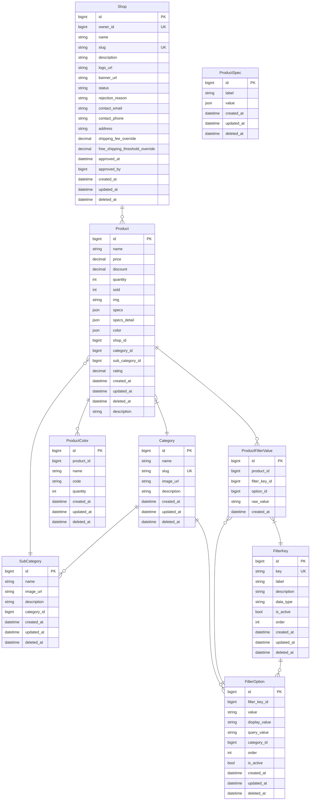
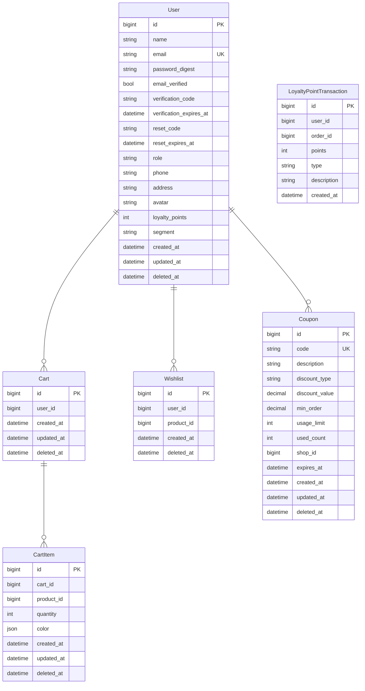
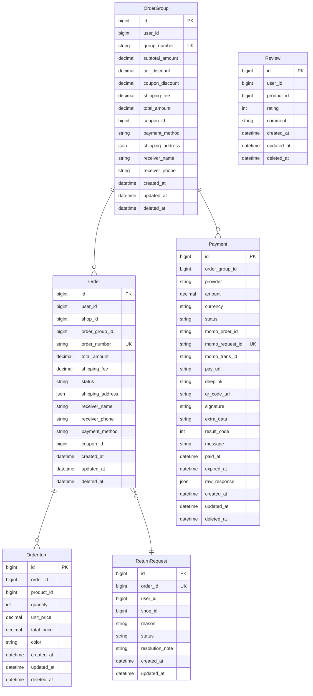
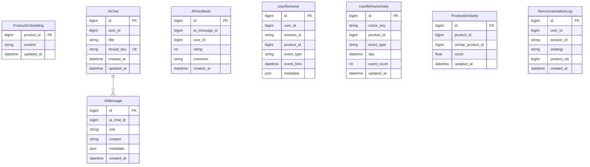
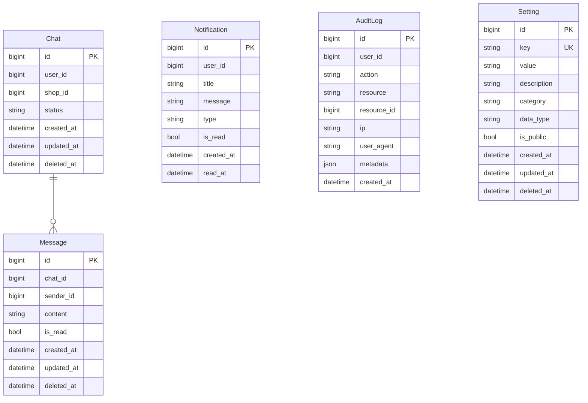

# So do quan he thuc the (ERD)

> Sinh tu `prisma/schema.prisma` bang `npm run docs:erd`.
> **Khong sua tay file nay** — sua schema roi chay lai lenh tren.

Tong cong 34 bang nghiep vu (chua tinh 2 bang ha tang cua
cong cu migration). Chia theo mien de doc duoc; quan he bac cau giua cac
mien duoc noi trong phan mo ta cua tung muc.

## 1. Gian hang va danh muc san pham

Xuong song cua mo hinh da gian hang: mot nguoi dung so huu toi da mot Shop, moi Product thuoc dung mot Shop.

## 2. Nguoi dung, gio hang va uu dai

User la trung tam: vua la nguoi mua, vua co the la chu shop (quan he ShopOwner).

## 3. Don hang, thanh toan va doi tra

Diem then chot cua sang da gian hang: mot lan thanh toan tao ra mot OrderGroup, roi tach thanh N Order — moi shop mot don, tu quan trang thai rieng.

## 4. Tri tue nhan tao

ProductEmbedding luu vector pgvector phuc vu truy hoi RAG; UserBehavior va ProductSimilarity phuc vu loc cong tac.

## 5. Ho tro va van hanh

Chat hai kenh (buyer-san va buyer-shop), thong bao, nhat ky thao tac va tham so van hanh.

